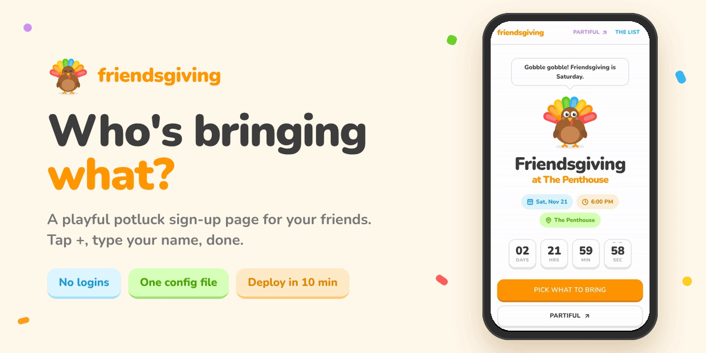
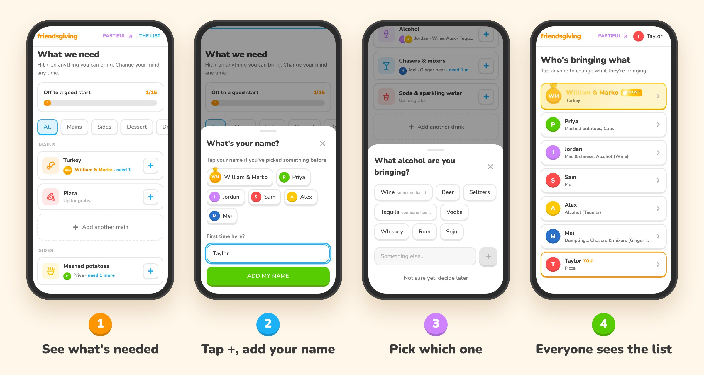
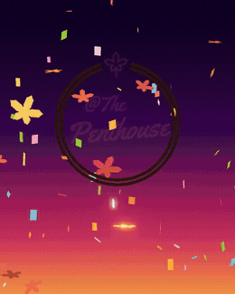

<p align="center">
  
</p>

<p align="center">
  <a href="#-throw-your-own-in-10-minutes"></a>
  
  
  
  
</p>

<p align="center">
  <b>The end of four people bringing mac & cheese.</b><br>
  Send one link. Friends tap <b>+</b> on what they'll bring. Everyone sees the list.
</p>

<br>

<p align="center">
  
</p>

## ✨ What's inside

<table>
  <tr>
    <td width="33%" align="center"><h3>🙅</h3><b>No sign-up</b><br><sub>Guests type their name once. Their phone remembers them.</sub></td>
    <td width="33%" align="center"><h3>🎯</h3><b>Goals per item</b><br><sub>“Turkey ×2” shows <i>need 1 more</i> until it’s covered.</sub></td>
    <td width="33%" align="center"><h3>🍷</h3><b>“Which one?” pickers</b><br><sub>Drinks ask what kind and mark what’s taken.</sub></td>
  </tr>
  <tr>
    <td width="33%" align="center"><h3>✏️</h3><b>Anyone can edit</b><br><sub>It’s for friends. Fix a pick with one tap.</sub></td>
    <td width="33%" align="center"><h3>👑</h3><b>Host badges</b><br><sub>Hosts get a gold crown and sit up top.</sub></td>
    <td width="33%" align="center"><h3>🦃</h3><b>Gobbles</b><br><sub>A talking turkey, a countdown and confetti.</sub></td>
  </tr>
</table>

RSVPs stay where they already work (Partiful, Luma, Evite). Add your link and the buttons point there.

## 🚀 Throw your own in 10 minutes

**1. Fork this repo.**

**2. Edit [`src/lib/event.ts`](src/lib/event.ts).** It's the only file you need to touch:

```ts
export const EVENT = {
  title: "Friendsgiving",
  startsAt: "2026-11-22T02:00:00.000Z",  // in UTC, drives the countdown
  dateLabel: "Saturday, November 21",
  shortDateLabel: "Sat, Nov 21",
  timeLabel: "6:00 PM",
  place: "The Penthouse",                // a nickname beats a street address
  rsvpName: "Partiful",
};

export const HOSTS = [{ name: "Sam" }, { name: "Alex" }];

export const SEED_ITEMS = [
  { slug: "turkey", category: "mains", label: "Turkey", need: 2 },
  { slug: "alcohol", category: "drinks", label: "Alcohol", need: 6,
    options: ["Wine", "Beer", "Tequila"] },  // options = "which one?" picker
  // ...
];
```

**3. Deploy on [Railway](https://railway.com).**
New Project → *Deploy from GitHub repo* → pick your fork. Then **+ Create → Database → PostgreSQL**, and on the web service add:

| Variable | Value |
| --- | --- |
| `DATABASE_URL` | `${{Postgres.DATABASE_URL}}` |
| `RSVP_URL` | *optional* your Partiful / Luma link |
| `APP_URL` | *optional* only for a custom domain |

**4. Settings → Networking → Generate Domain.** Send it to the group chat. 🎉

Tables create themselves on first boot. Edit the list any time and redeploy: nobody's picks get lost.

## 🎨 Make it yours



- **Text preview image:** swap `public/og.jpg` (1080×1350) and `public/og.mp4`.
- **Party flyer:** open `flyer/flyer-fun.html` in a browser, change the text, screen-record it for your story.
- **Colors:** `src/app/globals.css`.
- **Gobbles's lines:** top of `src/components/Hero.tsx`.
- **Not Thanksgiving?** Change the title and categories. Birthday picnic, game night, camping trip. The turkey can stay.

<br clear="right">

## 💻 Run it locally

```bash
docker run -d -e POSTGRES_PASSWORD=postgres -e POSTGRES_DB=fg -p 5432:5432 postgres:16
cp .env.example .env.local   # DATABASE_URL is already set for the line above
npm install && npm run dev   # → http://localhost:3000
```

Built with Next.js, Tailwind, Motion and plain Postgres.

<p align="center"><br>Made with 🥧 for Friendsgiving. Go throw a good party.</p>
